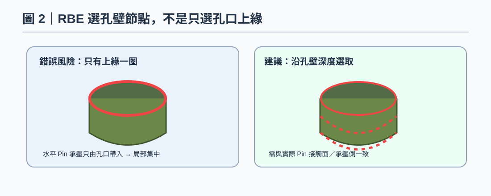
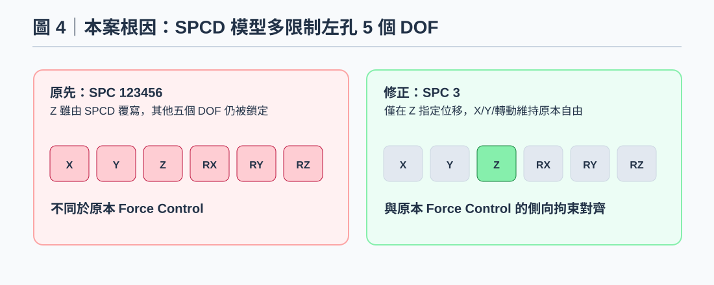

# OCP Rail — OptiStruct 水平拉伸 / SPCD 位移控制 / Test to Fail 工程知識

> 建立日期：2026-10-29 · 軟體：HyperMesh / OptiStruct / HyperView 2026 · 類型：技術知識 + 問題排除 · **驗證狀態：Force/SPCD 位移場對照已通過；反力、實體 Pin/Contact 及破壞準則尚待驗證**

> **圖面標示：**本頁圖片均依對話內容重繪為示意圖，**不是**原始截圖，也不是新求解的 H3D 結果；數值取自使用者當時提供的 HyperView 截圖。

## 一、案例摘要

【案例目的】以 OptiStruct 模擬 NC50RT 塑膠 OCP Rail 的 50 kgf（約 490 N）水平拉伸，並由 Force Control 轉為 Displacement Control，為後續 Test to Fail 建立方法。
【已驗證成果】原始 Force Control 下，左孔 RBE3 中心 Node 26088 的 Global Z 位移為 −1.101 mm，並非全模型最小值 −1.379 mm。把 SPCD 設為 −1.101 mm，且把左孔 SPC 由 123456 改為只有 3 後，兩模型最大位移 Magnitude 分別約 2.948 與 2.947 mm（差約 0.034%），應力輪廓亦幾乎重合。
【重要限制】尚未核實 SPCD 反力是否精確對應 490 N；目前可稱為載荷控制轉換驗證，不可稱為已預測破裂力。

## 二、模型、連接與分析原理

【模型／座標】Rail 長度方向為 Global Z。左孔承受 Z 向負力，右孔為固定端。獨立拉伸試驗只使用 Rail + 兩根 Pin；底部灰色 BKT 不存在於實驗的載荷路徑，因此正式代表實驗的模型不應為了符合他人結果而任意加 BKT。若做組裝狀態敏感度分析才考慮 BKT／Contact。

【RBE2 vs RBE3】RBE2 將指定 Dependent Nodes 的運動綁定到 Independent Center，會增加孔壁附近的理想化剛性。RBE3 以周圍節點加權運動定義 Reference Node，適合簡化分配力，但不等於真實 Pin–Hole 單側接觸。對孔壁局部破壞應以 Pin + Contact 檢查。水平推力的 Node 選取以 Hole 內壁沿深度的表面 Nodes 為原則，不是只選孔口上緣，也不需選實心體積內部 Nodes。選受力側或整圈須依物理接觸與簡化假設決定。

【原本的連接】左孔 RBE3（參考 Node 26088）施加 FZ=−490 N，右孔 RBE2（參考 Node 26087）SPC 123456。一般一階 Solid 的孔壁節點只有 123 平移自由度；曾出現 Auto-SPC 192 個自由度（64×456），來自右孔 RBE2 中無實際轉動剛度的 Solid 節點。這是對無效轉動 DOF 的自動處理，不表示 192 個平移方向被額外固定；有 Shell/Beam 混接時不得套用同樣結論。

【Tetra4 vs Tetra10】Tetra4 在彎曲／孔邊強梯度情況可能偏硬，Tetra10 通常有更佳應力解析能力；但二階 Contact 的面離散、Mid-side Node 及非線性收斂路徑可能改變結果，不能只因二階 Stress 更大就宣稱更真實。必須做孔邊局部網格收斂、RBE/Contact Surface 節點更新檢查，以及元素應力 Unaveraged 比較。

【Nut–Rail 界面】本案金屬 Nut／Insert 是塑膠成型後壓入（Press Fit），不是射出包覆或膠合。TIE 可作為簡化對照，但真實界面可能透過干涉預壓、摩擦與幾何卡合傳力；較完整版本為 Frictional Contact + 合理 Interference／壓入後殘留接觸狀態。單純改成無干涉 Contact 可能因缺乏法向壓力而過度滑動。應確認 Nut 相對位移、Contact Pressure、開離及塑性應變。

## 三、HyperMesh / OptiStruct 設定與重現步驟

1. 另存原始 Force Control 模型；保留 NLSTAT、LGDISP、材料、Nut–Rail Contact、Mesh、左孔 RBE3、右孔 RBE2 + SPC。
2. 對 490 N 求解的最後已收斂 Frame，在 HyperView 的 Contour 選 Displacement (Z) → Apply；再開 Measure，選 Nodal Contour → Nodes，Visibility Filter 設 All，輸入 RBE3 Reference Node 26088，讀取 UZ。這次讀到 −1.101 mm；不能拿全模型 Min −1.379 mm 當 Reference 位移。
3. 複製成 Displacement Control 版本，移除左孔原先的 FORCE −490 N；保留左側 RBE3，不需要為了 SPCD 改用 RBE2（LGDISP 下仍需檢查 Solver 的相依自由度處理）。
4. 在 SPC Collector 中，右孔中心維持 SPC 123456，左孔 Node 26088 只宣告 SPC 3=0；不要使用 123 或 123456，否則會額外鎖定 X、Y、旋轉 DOF，導致兩個模型邊界不一致。
5. 在另一個 Collector 建立 SPCD：Node=26088、DOF3（Global Z）、value=−1.101 mm。Load Step 設 SPC 指向 SPC Collector，LOAD 指向 SPCD Collector；保留 NLSTAT、LGDISP、NLPARM、NLOUT。
6. 執行後先比對兩版的 Node 26088 UZ、全模型 Displacement (Magnitude)、最大值位置與 Contact 狀態；本次結果 2.948（SPCD）vs 2.947 mm（Force），兩者最大位移皆 Grid 1345。
7. 在輸出中加入 SPCFORCE，查左側施加位移的反力與右端總反力，確認力平衡與其大小是否接近 490 N；再比較同一應力平均法、同一結果 Frame 的 Von Mises。務必取消原本固定在 60 MPa 的截斷色階後讀真實 Peak Stress。
8. 完成等效驗證後，再增加 SPCD 負位移（例如以 490 N 時的位移作第一個基準），在多增量中記錄 Reaction Force–Displacement、Plastic Strain、Contact Status。不要把 Solver 不收斂或首次超過 60 MPa 當作斷裂判據。

## 四、核心規則與判讀

- 50 kgf 是重力單位；若用 N–mm，50 kgf ≈ 490.3 N；此案例模型輸入約 −490 N，Global Z。
- SPCD 只控制指定 Reference Node 的對應 DOF；整體 Min UZ、最大位移 Magnitude、其他 GRID 的位移不必等於 SPCD 值。
- SPCD DOF 3 需在作用的 SPC 選集中宣告，其他 DOF 只在真實治具有拘束時才加入；同一自由度不可同時沿用原 FORCE。
- 核對等效時要比較相同的實體位置及 Component，並檢查 SPCFORCE、反力平衡、接觸狀態與塑性歷程；只看顏色或全模型極值不足以判定。
- 兩張 Stress 圖的 Legend Max=60 MPa 是顯示色階上限，不代表真實最大應力就是 60 MPa；Reference Node 若不屬 Solid Stress 評估點，量測 Stress 會顯示 N/A。
- 正式 Test to Fail 可採位移控制，但若模型只有彈塑性、不含經驗證的損傷／斷裂準則，就不能直接預測塑膠裂斷；Insert Pull-out 與塑膠破裂是不同失效模式。
- 本知識中的節點 ID（26088、26087）、位移（−1.101 mm）為此案例值，勿複製到其他 Geometry、網格版本後直接套用。

## 五、問題排查與結果

**問題：** 同一 OCP Rail 用 Force −490 N 或 SPCD −1.101 mm，左孔 Reference Node 26088 的 UZ 都是 −1.101 mm，但全模型最小 UZ、Stress Contour 差異明顯。最初 SPCD −1.379 mm 時又出現更大差異。

**原因：** (1) 用整個模型最小 UZ −1.379 mm 取代 Reference Node 位移 −1.101 mm，行程多了 0.278 mm；(2) 左孔 RBE3 Reference Node 26088 在 SPCD 版被設為 SPC 123456，額外限制 1、2、4、5、6 DOF。原 Force 版左孔為自由加力端；拘束條件不同導致孔壁變形／接觸／應力不同。

**已確認的結果：** 修改後左側 SPCD 版最大位移 Magnitude = 2.948 mm；右側 490 N Force 版 = 2.947 mm，相差約 0.034%，最大值皆為 Grid 1345，兩張 Von Mises Contour 外觀近乎相同。因兩圖 Stress Legend 上限 60 MPa，尚未確認未截斷的最大應力；SPCFORCE 反力仍待核對。

## 六、後續工作與限制

【失敗排查紀錄】(a) 把全模型最小 UZ −1.379 mm 當作左孔施力中心行程，SPCD 版本比 Force 版本多拉約 0.278 mm。（b）改回 −1.101 mm 後兩版仍不同，查得 SPCD 左孔誤設為 SPC 123456；修正為只 SPC 3，位移與 Stress 趨於一致。（c）開 Vector Plot 查單點時畫面滿是向量，改以 Contour + Measure → Nodal Contour 並將 Visibility Filter 改 All。（d）Auto-SPC 192 來自 Solid 孔壁 RBE2 的轉動自由度，不是額外固定平移。

【未完成】仍需確認 SPCD = −1.101 mm 的 SPCFORCE 反力是否約為 490 N；需確認試驗治具中的 Pin 旋轉與 X/Y 滑移自由度；Press Fit 干涉量、摩擦係數及材料失效模型仍待實驗數據；需要 Pin + Contact 版本和 Tetra10 網格收斂。

【圖片說明】附圖為根據本次對話與所見截圖重繪的工程說明圖，不是從原始 H3D 擷取的截圖或新一輪計算結果。

## 七、配圖

### 圖 1｜測試 A：只有 Rail + 兩根 Pin

水平拉伸力路徑與右端固定，Global Z 為 Rail 長度方向。

### 圖 2｜孔壁 Node 的正確選取區域

水平 Pin 載荷須選內壁沿厚度方向的節點，勿只選上口；示意圖，非原始模型截圖。

### 圖 3｜壓入式 Nut：TIE 與 Contact

壓入固定應評估干涉、預緊及摩擦，不可把 SLIDE Contact 視同完全黏合。

### 圖 4｜真正造成兩版結果不一致的 BC 差異

左孔原先使用 SPC 123456；修正為 SPC 3 後，Force 與 SPCD 結果接近。

### 圖 5｜Force vs SPCD 的驗證結果

原本 490 N 模型左孔中心 UZ=−1.101 mm；修正後最大位移幅值 2.947 vs 2.948 mm。

### 圖 6｜一階與二階四面體單元比較

Tetra10 可改善部分彎曲及孔邊應力精度，但需核對中點節點、Contact 和網格收斂。

## 八、引用與數據來源

使用者提供的 OCP Rail OptiStruct 工程模型、HyperView 2026 截圖與 2026-10-28～29 對話紀錄。補充參考：Altair OptiStruct 使用手冊（SPC/SPCD、RBE2/RBE3、NLSTAT、Contact、SPCFORCE）。工程示意圖均重新繪製；數值以截圖所見為準，未經獨立求解重算。

---

**知識庫導覽：**此專案的正式文章和圖片由 Supabase 依使用者登入存取；這次 GitHub 分支新增的是**公開本機範例資料**，可在合併後透過 `?source=local` 測試。它不會自動寫入正式 Supabase。
