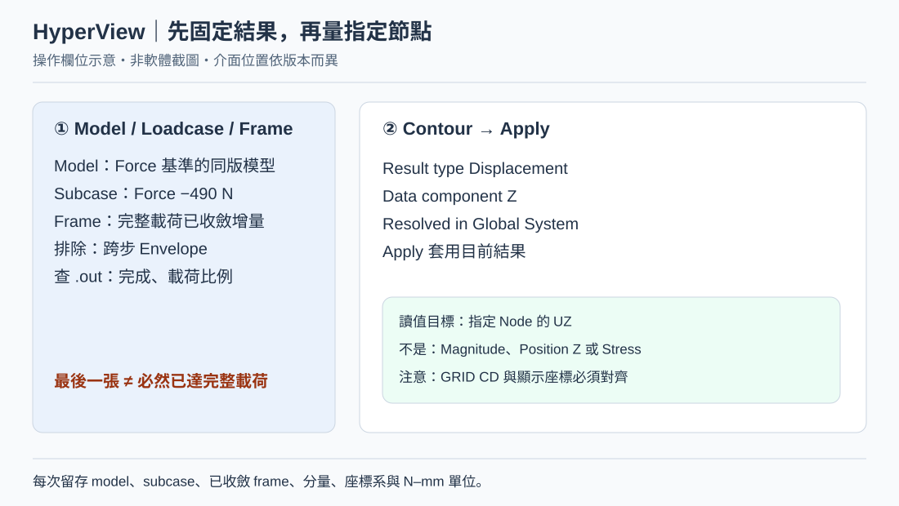
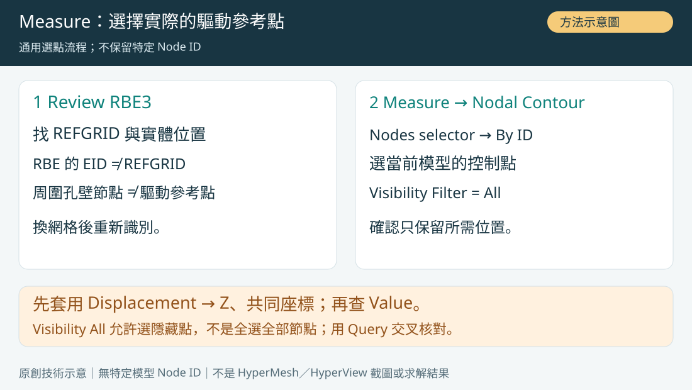
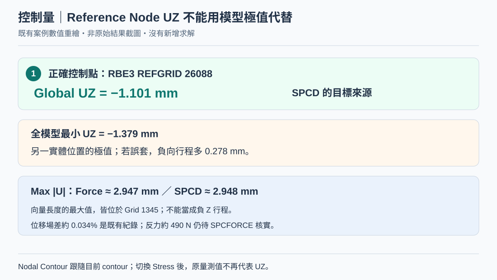
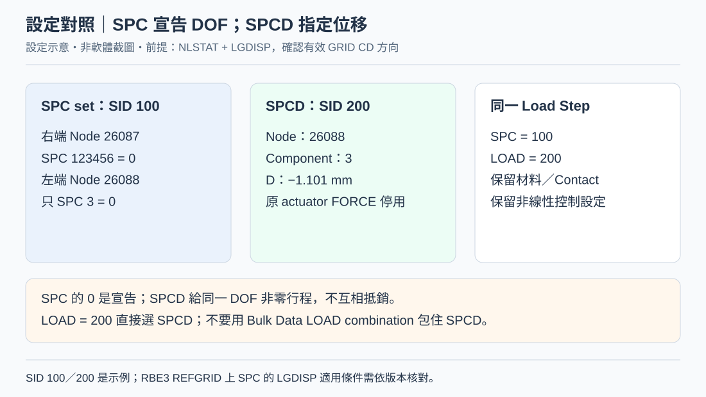

# OCP Rail｜HyperView 量測驅動點 UZ → Force／SPCD 完整圖文教學

> 方法型知識文章；不保留特定模型 Node ID 或單點讀值。所有圖片為示意，非求解結果。

[開啟本機預覽](../../index.html?source=local#ocp-rail-hyperview-node-uz-force-to-spcd-20261029)

## 知識摘要

從 Force 基準結果選取正確的 RBE3 參考點，在共同座標讀取 UZ，再以 SPCD 重現相同控制自由度，最後用 SPCFORCE 和平衡驗證等效性。保留操作順序，不使用案例 Node ID 或指定行程數值。

## 技術說明

【符號】u_ref 表示在目標基準載荷下量測的驅動點位移，F_ref 表示專案基準力。兩者不是通用單位換算。

【控制量】驅動點 UZ、全模型最小 UZ 與最大位移 Magnitude 是不同量；只能用同一物理位置與同一自由度的位移指定 SPCD。

【路徑】相同終點位移不保證接觸、摩擦、塑性與多重平衡路徑相同。替代載荷仍須驗證反力及內部狀態，規範 waive 由工程負責人核准。

## 操作步驟

1. 另存 Force 基準模型與結果，記錄版本、單位、分析類型、治具與接觸設定。
2. 在 HyperMesh Review 驅動端 RBE3 的 REFGRID，按實體位置識別控制點；重新劃網格後重查，不沿用舊編號。
3. 核對控制點有效 GRID CD 與載荷 CID；只有對齊同一 Z 方向時，Global UZ 才能直接對應該 DOF 3。
4. 在 HyperView 載入配對的模型與結果，確認 active model，避免選到另一個疊圖模型。
5. 選 Force 基準 Subcase 與目標載荷的已收斂增量，從 .out 確認載荷確實到位，不使用跨步 Envelope。
6. 開 Contour，Result type 選 Displacement，Data component 選 Z，Resolved in 選共同 Global System，按 Apply。
7. 開 Measure，選 Nodal Contour 與 Nodes，啟用值與節點識別資訊顯示；量測跟隨目前的 Contour。
8. 進入 Nodes selector／By ID；Visibility Filter 設 All 以允許選取隱藏點，不是全選整個模型。
9. 選上一步識別的驅動參考點，確認清單只保留目標位置；節點編號由當前模型決定。
10. 讀取帶符號 UZ 並保存足夠精度，將其記為 u_ref；同時記錄檔案、Subcase、Frame、方向與單位。
11. 使用同一 Contour 的 Node Query 交叉核對位移；切到 Stress 後不可把量測欄當作 UZ。
12. 排除錯讀：全模型 Min UZ、Max Magnitude 與 Position Z 均不能取代驅動點的位移分量。
13. 建立基準記錄 F_ref、u_ref、方向與增量；必要時保存整段載入曲線。
14. 理解 Force→SPCD 是以求解得到的位移重現狀態；F_ref／u_ref 只是該狀態割線剛性，不能外推成整段常數。
15. 另存 SPCD 模型，保持材料、網格、接觸及其他外力；移除原驅動 FORCE 並核對 active Subcase。
16. 保留支承端真實拘束；驅動點只宣告需要的 SPC 自由度。若為對齊 Z 的單軸案例，通常只宣告 3，不能任意增加側向拘束。
17. 確認 RBE3 REFGRID 上 SPC 的 NLSTAT + LGDISP 適用條件與相依 DOF，出錯先查卡片與版本。
18. 建立 SPCD，選同一控制點、同一 Component，D 填入帶符號 u_ref；核對單位與座標。
19. 在 Load Step 的 SPC 選作用約束集合，LOAD 直接選 SPCD SID；SPCD 不可包進 Bulk Data LOAD combination。
20. 加入 DISPLACEMENT(H3D)=ALL、SPCFORCE(H3D)=ALL 與所需 STRESS；用 NLOUT 儲存收斂增量。
21. 先查 .out 是否正常完成、行程是否到位及有無新增 Auto-SPC／相依 DOF 警告。
22. 在 SPCD 結果重複同一控制點 UZ 查詢，確認達到 u_ref，且其他自由方向沒有被多鎖。
23. 比較兩版整體位移場與最大值位置，記錄差異；不能只憑一個極值接近就宣稱等效。
24. 在同一已收斂增量選 SPC Forces → Z，Resolved in 共同座標，分別讀驅動端與支承集合的帶符號力。
25. 將符號統一為治具對結構施力，分端比較基準力；若工具顯示反向作用力，先轉成同慣例。
26. 用 F_ref 正規化計算力差及平衡殘差，包含所有外部作用，兩端只計一次，不重複計內部接觸力。
27. 使用一致應力種類、平均法與輸出位置，比較接觸開閉、滑移與材料歷程；反力不符時逐項排查。
28. 只有位移場、反力、平衡與狀態均符合專案容許差，才記錄為該模型狀態的等效驗證；沒有結果時保持待驗證。

## 判讀規則

- 驅動點使用實體位置識別，編號由當前模型決定。
- 保持相同自由度、座標與單位，量測 u_ref 並以 SPCD 重現。
- 檢查位移場、SPCFORCE、平衡與歷程，不能只看圖片顏色。
- RBE／MPC 相依與 LGDISP 適用條件需依版本核對。

## 注意事項

找不到節點：確認 model/result 配對、active model、By Node ID、Visibility Filter=All、ID 是否被重新編號，以及結果有無該 GRID。N/A：先排除沒有 contour、讀 Stress、錯 frame 或輸出未含該點；仍缺資料時回原 deck 請求位移輸出重算，不捏造數值。滿畫面向量：關 Vector plot，保留 Contour＋Measure 即可。

專題延伸：[SPCFORCE 詳細驗證與證據表](#ocp-rail-spcforce-equivalence-20261029)、[SPC 123456 → 3 排錯紀錄](#ocp-rail-spcd-123456-mismatch-20261029)、[RBE3 與 Auto-SPC 適用條件](#ocp-rail-rbe-hole-nodes-autospc-20261029)

延伸閱讀：[OCP Rail 知識線索引](#ocp-rail-force-spcd-test-to-fail-20261029)

後續專題：[SPCFORCE／NLOUT 與 60 MPa Stress-limit Load](#ocp-rail-spcforce-stress-limit-20261029)（保留上游既有教學，門檻載荷仍待原模型驗證）。

候選方法：[Two-Stage Adaptive Time Increment Control](#optistruct-nlstat-two-stage-adaptive-time-increment-control-20261029)（官方規則已核對，兩階段完整組合待求解驗證）。

## 參考來源

方法型教學；不使用特定模型的節點編號、位移或峰值結果作為操作模板。未執行新的 OptiStruct 求解。官方文件依實際版本核對。
https://2025.help.altair.com/2025.1/hwdesktop/hlife/topics/panels/measure_panel_define_measure_group_t.htm
https://2025.help.altair.com/2025.1/hwdesktop/hwx/topics/panels/input_collector_ext_entity_selection_menu_r.htm
https://2025.help.altair.com/2025.1/hwdesktop/hwx/topics/user_interface/selection_advanced_t.htm
https://2019.help.altair.com/2019/tutorials/hv-3000.pdf
https://2025.help.altair.com/2025/hwsolvers/altair_help/topics/solvers/os/grid_bulk_r.htm
https://2025.help.altair.com/2025/hwsolvers/altair_help/topics/solvers/os/spcd_bulk_r.htm
https://2025.help.altair.com/2025/hwsolvers/altair_help/topics/solvers/os/rbe3_bulk_r.htm
https://2025.help.altair.com/2025/hwsolvers/os/topics/solvers/os/spcforce_io_r.htm

## 圖解

### Step 6｜先固定結果、Z 分量與座標系

操作欄位示意，非 HyperView 原始截圖；先確認完整載荷已收斂，再 Apply Displacement / Z / Global。

### Step 9｜Measure：選擇當前模型的驅動參考點

方法示意：由 RBE 卡識別實體位置，使用 By ID 選取並確認；不保留特定 Node ID。

### Step 12｜驅動點位移與全模型極值的差異

方法示意：u_ref 為量測符號；全模型極值與位移 Magnitude 不能取代驅動點分量。

### Step 19｜SPC／SPCD／Load Step 的對應

設定示意，非軟體截圖；LGDISP 前提，CD 方向核對，LOAD 直接選 SPCD SID。

### Step 25｜SPCFORCE：分開兩端，再查力平衡

預期符號與驗證方法示意，非已量測反力；本案例約 490 N 仍待實際輸出確認。

### Step 23｜Force→SPCD：量測與驗證流程

方法示意：以實際驅動位置的量測位移重現狀態，並核對反力、平衡與歷程。
