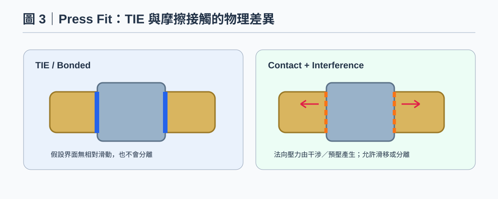

# OCP Rail｜壓入式 Nut／Insert：TIE、Frictional Contact 與 Press Fit 初始狀態

> 方法型知識文章；不保留特定模型 Node ID 或單點讀值。所有圖片為示意，非求解結果。

[開啟本機預覽](../../index.html?source=local#ocp-rail-press-fit-contact-20261029)

## 知識摘要

本案例 Nut／Insert 為塑膠成型後壓入；TIE 可作比較基準，但不能據此代表真實干涉預壓、摩擦滑移與拔出。建立接觸版本時，需要壓入後的初始狀態與實驗參數。

## 技術說明

TIE 是理想化連結；無干涉的可滑動 Contact 也不等同壓入固定。真實界面可能透過干涉、摩擦與幾何卡合傳力；缺少法向壓力時容易過度滑動。干涉量、摩擦係數與製程殘留狀態尚未取得，本條目提供建模與比對路線，不宣稱已驗證任何數值。

## 操作步驟

1. 確認 Insert 是壓入、射出包覆、膠合或其他製程；記錄尺寸公差、干涉量與試驗狀態。
2. 保留 TIE 理想化基準，另外建立 Frictional Contact 版本，記錄接觸對、初始間隙、摩擦、面法向與允許開離。
3. 以適合求解器的干涉／壓入程序建立預壓狀態；主拉伸分析須繼承相同初始狀態，不能每個比較模型各用不同接觸起點。
4. 比對 Contact Pressure、開離、滑移、Insert 相對 Rail 位移與塑性應變；若缺少實驗參數，將範圍列為敏感度，不填假精準常數。
5. 力／位移控制比較時保持界面設定與載入歷程；完成[SPCFORCE 驗證](#ocp-rail-spcforce-equivalence-20261029)後，才討論後續拔出或破裂。

## 判讀規則

- Contact 名稱不是物理驗證；確認實際卡片與傳力方式。
- TIE 可用來辨識界面柔度影響，不能當作唯一真實模型。
- Insert pull-out 與塑膠裂斷是不同失效模式。

## 注意事項

本次未建立新接觸模型或決定摩擦係數。延伸：[載荷路徑與治具](#ocp-rail-fixture-load-path-20261029)、[Test to Fail 限制](#ocp-rail-test-to-fail-limits-20261029)

延伸閱讀：[OCP Rail 知識線索引](#ocp-rail-force-spcd-test-to-fail-20261029)

## 參考來源

方法型教學；不使用特定模型的節點編號、位移或峰值結果作為操作模板。未執行新的 OptiStruct 求解。官方文件依實際版本核對。

## 圖解

### 壓入式 Nut：TIE 與 Contact

壓入固定應評估干涉、預緊及摩擦，不可把 SLIDE Contact 視同完全黏合。
