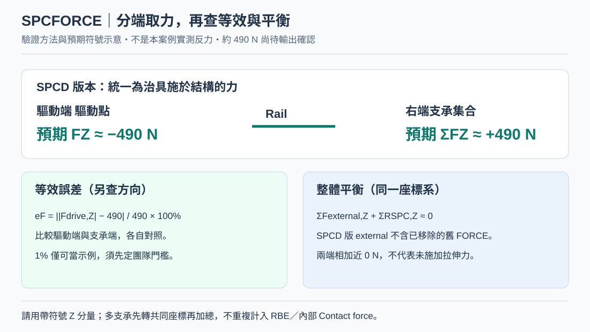

# OCP Rail｜SPCFORCE 驗證 Force／SPCD 等效：符號、支承加總與平衡

> 方法型知識文章；不保留特定模型 Node ID 或單點讀值。所有圖片為示意，非求解結果。

[開啟本機預覽](../../index.html?source=local#ocp-rail-spcforce-equivalence-20261029)

## 知識摘要

SPCD 指定位移後，必須查反力是否重現 −490 N。將驅動端與支承端分開、在同一座標系比較帶符號 FZ，並核對整體平衡、接觸與塑性狀態；全模型總反力接近 0 並不代表未施力。

## 技術說明

【預期而非實測】若定義為治具施於結構的力，Force 版左外力 −490 N、右端反力約 +490 N；SPCD 版左驅動約 −490 N、右端約 +490 N。若讀的是結構作用於治具的力，符號反向，應先統一慣例。不能只取 |F| 而忽略反向載入。

【取集合】右端若所有支承都傳到單一中心 支承點，可讀該中心；若還有其他 SPC，需把實際支承節點集合逐項帶符號加總。不要把同一 RBE 載荷在中心與孔壁重複加計，或把 MPCFORCE／內部 Contact force 當成額外外力。

【輸出】SPCFORCE(H3D,OPTI)=ALL 為示例，H3D 可後處理，OPTI 可檢查 .spcf；若無 request，不能期待事後出現結果。NLOUT／SPCFORCE nlout 選項控制所需增量輸出，仍要核對實際求解版本。

## 操作步驟

1. 保留配對 Force／SPCD 的 FEM、OUT、H3D／SPCF 檔，列出相同模型／網格／材料／接觸狀態。先完成[指定 Node UZ 教學](#ocp-rail-hyperview-node-uz-force-to-spcd-20261029)。
2. 在兩版加入 SPCFORCE 輸出與必要增量輸出，重新求解後確認有資料；Force 基準也要查固定端，不只查 SPCD。
3. 讀 .out 的完成狀態、載荷比例、SPCFORCE／reaction summary；確保兩版比較的都是完整 −490 N／u_ref 已收斂狀態。
4. HyperView 中選 SPC Forces 結果、Z component、Global System（依版本結果標籤可能略異），Apply 後以 Query 找左端 驅動點 與右端支承。不要沿用 Displacement 的結果欄位。
5. 依輸出座標轉換後保存每個節點的帶符號 FZ。若從 .spcf 匯出，核對 Basic／user／analysis 系統說明；不同 local 系統的分量須先轉同一系統再加總。
6. 用 Force 基準的已知外力方向確認符號慣例：右固定端總力應抵銷 −490 N，再把 SPCD 的兩端反力轉成同樣慣例。
7. 查驅動力誤差 eF = ||Fdrive,Z| − 490| / 490 × 100%。方向亦需符合；右端總反力與 Force 版的支承總反力另作比較。
8. 查平衡 eBal = |ΣFexternal,Z + ΣRSPC,Z| / 490 × 100%。SPCD 版舊 actuator FORCE 已移除，左、右端 SPC 各算一次；若只有這兩端，兩者相加應接近 0。
9. 核對 X/Y 平衡與同一參考點的力矩；如果模型還有重力、其他外力、額外支承或穩定化作用，全部列入對帳，不能硬套兩端平衡式。
10. 把各已收斂增量的驅動位移 UZ 與反力畫成 F–u 曲線；對照相同控制點位移、接觸開閉／摩擦滑移、塑性狀態。終點力相近仍不保證整條路徑一致。
11. 在比對前訂定允收誤差；例如 1% 可作示範門檻，但不是 Altair 通用標準或此案既有驗收規範。與收斂公差、位移 rounding 及實驗精度一起評估。
12. 填證據表：模型版次、檔名、frame／載荷比例、驅動點 UZ、左驅動 FZ、右支承 ΣFZ、其他外力、eF、eBal、接觸／塑性狀態、判定。缺數據填待驗證，不能用示意圖或預期值當實測。

## 判讀規則

- Max SPC Force Magnitude 不等於整體拉伸力；多節點支承需加總同向帶符號分量。
- SPCD 版把兩端所有 SPC 直接加總，可能接近 0 N；驗證驅動力時必須先分端。
- Force 版外力和 SPCD 版驅動反力不可在同一模型重複算入。
- 以實際基準力 F_ref 與量測位移 u_ref 建立比較；力差、平衡殘差及狀態需由各專案保存證據，不預設已通過。

## 注意事項

若反力偏離 490 N，先查方向／frame／載荷比例、SPC 123456 殘留、舊 FORCE、CD／CID、RBE 權重與節點、接觸預壓與歷程、不同材料／網格、位移小數截斷。不要先調 SPCD 數字湊反力來掩蓋不一致。相關：[SPC 123456 排錯](#ocp-rail-spcd-123456-mismatch-20261029)、[Test to Fail 與驗證範圍](#ocp-rail-test-to-fail-limits-20261029)

延伸閱讀：[OCP Rail 知識線索引](#ocp-rail-force-spcd-test-to-fail-20261029)

後續專題：[SPCFORCE／NLOUT 與 60 MPa Stress-limit Load](#ocp-rail-spcforce-stress-limit-20261029)（保留上游既有教學，門檻載荷仍待原模型驗證）。

## 參考來源

方法型教學；不使用特定模型的節點編號、位移或峰值結果作為操作模板。未執行新的 OptiStruct 求解。官方文件依實際版本核對。
https://2025.help.altair.com/2025/hwsolvers/os/topics/solvers/os/spcforce_io_r.htm
https://2025.help.altair.com/2025/hwsolvers/altair_help/topics/solvers/os/grid_bulk_r.htm

## 圖解

### Step 8｜驅動端與支承端分開取力

圖中 ±490 N 為預期驗證目標，尚未取得本案例實際 SPCFORCE；不是求解結果。
