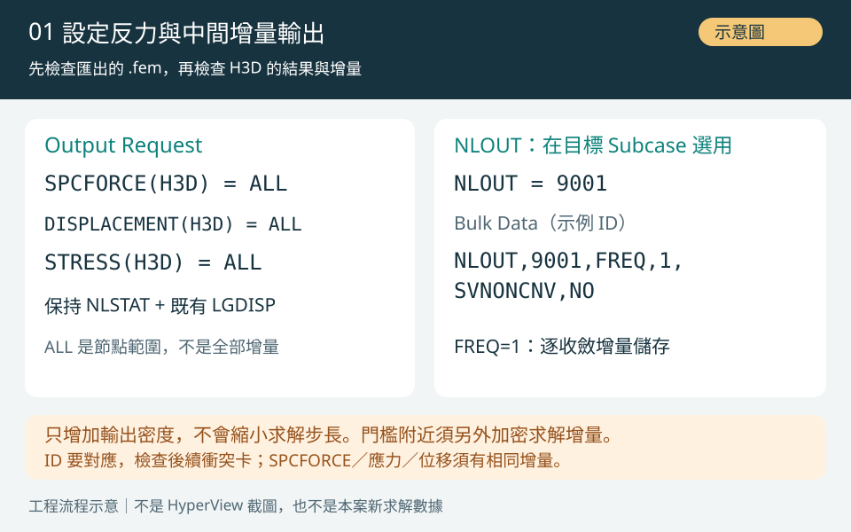
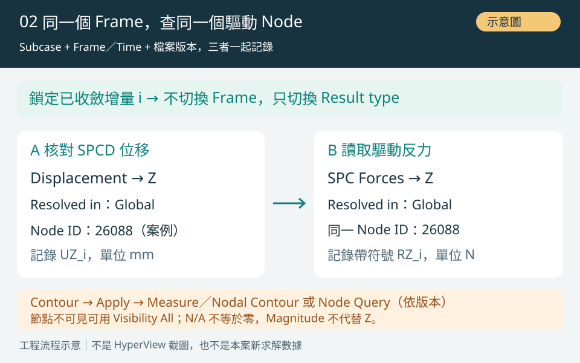
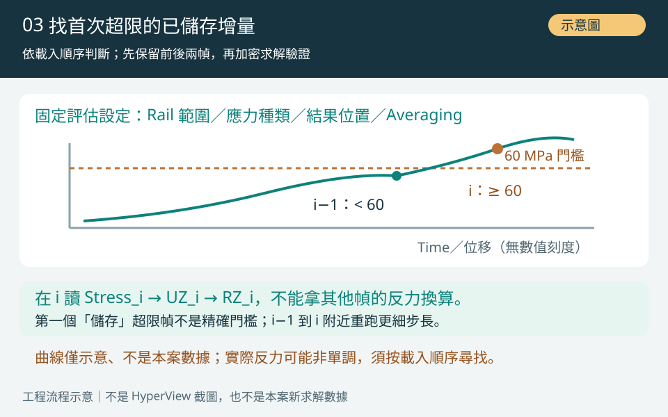
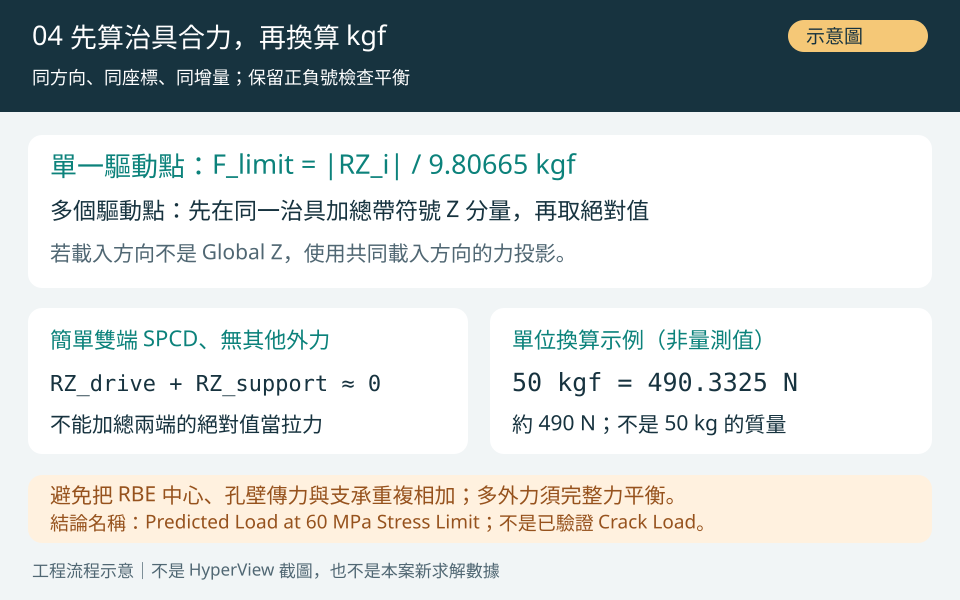

# SPCFORCE 反力教學｜OCP Rail 的 Force→SPCD 等效驗證與 60 MPa Stress-limit Load

> 2026-10-29 · OptiStruct／HyperView · 技術知識 · 教學方法待原模型驗證
> 所有配圖為**示意圖**，非軟體截圖或新求解結果。

[回到 Force→SPCD 完整教學](ocp-rail-force-spcd-test-to-fail.md) · [本機文章入口](../../index.html?source=local#ocp-rail-spcforce-stress-limit-20261029)

## 案例與用途

以 OptiStruct NLSTAT + LGDISP 的 SPCFORCE(H3D) = ALL 輸出約束反力，先確認 Force→SPCD 的 50 kgf（約 490 N）等效性，再找 Rail 首次達到指定 60 MPa 門檻的已收斂輸出增量，讀取同一增量的驅動反力並換算 kgf。
本篇是操作方法，未重新求解 OCP Rail，也未取得新的 H3D 反力；實際門檻載荷仍待模型驗證。圖均為示意圖。

## 原理與判定範圍

【SPCFORCE 是什麼】SPCFORCE 是單點約束的反力／反力矩結果，不是施加的 FORCE 卡片，也不是元素 FORCE 或 MPCFORCE。SPCD 在受約束的指定自由度施加非零位移；該驅動自由度的反力可用來建立載荷–位移曲線。參考節點若屬 RBE 連接，仍應核對相依自由度、反力傳遞與整體平衡。

【本案例基準】既有 Force 模型輸入 FZ = −490 N；左孔 RBE3 Reference Node 26088 的 UZ = −1.101 mm。SPCD 版對應同一節點、同一 Global Z、左孔只 SPC 3，右孔沿用原約束。2.948 vs 2.947 mm 的最大位移接近只支持位移場對照，尚未證明驅動反力等於 490 N。節點 ID 與位移僅適用原案例。

【工程判定】60 MPa 是本教學採用的專案應力門檻示例，NC50RT 在實際溫度、含水率、成型方向與應變率下的允許值仍須由材料資料或試驗核准。若專案規定 Von Mises ≥ 60 MPa，依該準則報告；若評估拉伸型脆性破壞，需另評估最大主拉應力／主應變及相應拉伸門檻，不可把兩種準則的數值直接互換。

【彈性模型的用途】若目的僅為找指定應力門檻，可在適用範圍內保留 MAT1 彈性材料並逐步增加 SPCD；LGDISP 與接觸仍可能使整體反應非線性。MAT1 的 ST 允許拉應力不會自動生成裂紋；未校準損傷、斷裂與試驗關聯的模型不能給出真正 Crack Load。

## 操作步驟

1. 建立可對照的 SPCD 模型：依 Force→SPCD 教學量測原 Force 模型驅動 Node 的 UZ，再設定該 Node／DOF 的 SPCD，移除原驅動 FORCE，保留相同材料、網格、接觸、治具自由度與載入歷程。先用 −1.101 mm 的案例基準做等效驗證，再另外增加行程找門檻。
2. 在 HyperMesh 的 Global Output Request 或目標 Load Step Output Request 加入 SPCFORCE，Format 選 H3D，Option 選 ALL；同步輸出 DISPLACEMENT(H3D) = ALL 與 STRESS(H3D) = ALL。保留 NLSTAT 與既有 LGDISP 設定；匯出 .fem 檢查真的含 SPCFORCE(H3D) = ALL，且沒有後面的衝突卡片覆蓋。這只是結果輸出，不會施加力或啟用斷裂。
3. 確認該非線性 Subcase 有選用 NLOUT = 9001，並有對應 Bulk Data，例如 NLOUT,9001,FREQ,1,SVNONCNV,NO（9001 為可替換示例 ID）。FREQ=1 用來保留每個收斂載荷增量的中間結果；若沿用 NINT，輸出可能跳過已求解增量。NLOUT 不會縮小求解增量；門檻附近仍須調整非線性增量控制。重新求解並檢查 .out／收斂紀錄，確認 H3D 同時有位移、應力與 SPC Forces 的相同增量，不能只存最後一幀。
4. 在 HyperView 載入同一次求解的模型與主 .h3d，選正確 NLSTAT Subcase 與已收斂 Frame，記錄 Subcase、Frame／Time 與結果檔名。先套用 Displacement → Z、Resolved in = Global，使用 Measure → Nodal Contour（或 Query → Nodes，依版本名稱）按 ID 查驅動 Node 26088；Visibility Filter 設 All 或顯示該 Node，核對該增量實際 UZ。
5. 保持同一 Subcase／Frame，Contour Result type 改為 SPC Forces（可能顯示 SPC Force），Component 選 Z、Resolved in = Global，Apply 後以 Nodal Contour／Node Query 讀同一驅動 Node 的帶正負號 RZ，記錄 N。若沒有此結果類型、數值 N/A 或意外為零，先查輸出卡、檔案版本、節點／DOF、SPC 選集與 RBE 相依關係；不要把 N/A 當 0，也不要改讀全模型最大 Magnitude。
6. 對 50 kgf 基準，先核對實際驅動 UZ = −1.101 mm 的增量，將左側驅動 RZ 與右側支承反力用同一座標／分量檢查平衡；|RZ| 應與原模型輸入約 490 N 比較並報告差異，再檢查位移場、應力與接觸狀態。通過此檢查後才在加大行程的模型依載入順序逐幀檢查 Rail 應力，找第一個已收斂且評估應力 ≥ 60 MPa 的已儲存增量 i，並保留前一個低於門檻的增量 i−1。
7. 鎖定門檻增量 i，記錄應力種類、元素／位置、Centroid 或 Corner、Averaging、Time、驅動 UZ，再切回 SPC Forces → Global Z 讀同一增量的 RZ。單一驅動點的門檻載荷 F_limit(kgf) = |RZ_i| / 9.80665；多個驅動點則先對同一治具的帶符號力做分量合計／投影，再取絕對值。不要把左右兩端或 RBE 中心與孔壁傳力重複相加。
8. 在增量 i−1 到 i 附近加密求解步長並重跑，確認首次超限的解析度與網格收斂。報告命名為 Predicted Load at 60 MPa Stress Limit，附前後增量、RZ、kgf、位移、準則、平均法與誤差／未驗證事項。若全程未到 60 MPa，記為「已驗證行程內未達門檻」；若不收斂先停止，記為「未能判定」，不可把最後收斂點當作破裂點。

### 匯出 deck 的增量輸出設定片段（示例）

以下不是完整可求解模型；把設定加入既有 NLSTAT／LGDISP deck，保留原 SPC、SPCD、LOAD、材料與非線性控制。ID 9001 須為未衝突且對應的 NLOUT ID。

```text
$ I/O Options / above SUBCASE
SPCFORCE(H3D) = ALL
DISPLACEMENT(H3D) = ALL
STRESS(H3D) = ALL
$ In the existing target NLSTAT SUBCASE
  NLOUT = 9001
$ In Bulk Data, after BEGIN BULK
NLOUT,9001,FREQ,1,SVNONCNV,NO
```

### Step 2｜SPCFORCE 與 NLOUT 增量輸出



示意圖：Output Request 與 NLOUT 必須同時核對；範例 ID 需與模型一致。

### Step 5｜同一 Frame 查位移與反力



示意圖：鎖定相同 Subcase／Frame，於驅動 Node 讀 Global Z 分量。

### Step 6｜找首次儲存超限增量



示意圖：i−1 低於門檻、i 首次達到門檻，反力必須取自 i；無本案量測曲線。

### Step 7｜治具合力、平衡與 kgf 換算



示意圖：單點／多點先取帶符號合力；490.3325 N 僅為單位換算示例。

## 換算與判讀規則

- 單位：在一致的 N–mm 單位制下，1 kgf = 9.80665 N；50 kgf = 490.3325 N ≈ 490 N，490 N / 9.80665 ≈ 49.966 kgf。kg 是質量，kgf 是力。這是單位換算，不是本案新量測反力。
- 只讀同一增量：Stress_i ↔ UZ_i ↔ RZ_i；首次儲存超限幀不一定就是連續載入過程的精確門檻。先在位移／Time 軸夾住 i−1 與 i，不假設反力一定單調；插值只能是估計。
- Time 是 NLSTAT 載入歷程參數；即使某線性 ramp 下位移比例可由 Time 推得，LGDISP、接觸或材料非線性也不保證反力同比例。Time = 0.917812 不能直接乘 490 N 推算 SPCD 反力。明確 FORCE 比例載入的外力倍率也不是 SPCD 反力倍率。
- 拉力用同一物理方向的分量／投影；Magnitude 是向量長度，不能代替 Z 分量做帶符號力平衡。若 GRID CD 使用局部座標或載入方向轉動，先轉到共同座標再比較。
- 準靜態整體平衡應包含全部外部約束反力、施加外力及其他外部作用；內部接觸力不可重複計入。無其他外力的簡單雙端 SPCD 模型可檢查 RZ_drive + RZ_support ≈ 0。勿將全部 SPC 節點相加的接近零結果當成拉力。

## 限制與驗證

【應力顯示】59.948 MPa 的 Simple Average 顯示只表示該平均設定下接近 60 MPa，不能直接當首次超限，更不能稱裂紋。固定 Legend Max = 60 只會截斷色階，應改讀真正數值。Simple／Compute then average 與 Advanced／Average then compute 可能不同；保留原平均法作對照，並查看 Unaveraged 元素結果、Centroid／Corner 與輸出位置。沒有 Corner 輸出時不要宣稱已查 Corner 峰值。

【網格與奇異點】Unaveraged 也不是自動正確答案；RBE、點拘束、接觸邊緣與尖角可能出現對網格敏感的尖峰。需記錄熱點位置、局部網格尺寸與元素階次，至少比較逐步細化後的門檻載荷、力–位移與熱點應力；若峰值持續升高不收斂，需檢查理想化／奇異性並建立有依據的評估區域，不可任意刪掉最大值。單節點 SPCFORCE 分配也受網格與元素種類影響，治具合力與整體平衡須一起檢查。

【材料與結論】60 MPa 不是已確認的 NC50RT 裂紋強度。僅以彈性應力門檻定義的載荷稱 Stress-limit Load；實際 Crack Load、裂紋擴展、斷開或 Insert Pull-out 需要各自經實驗校準的模型與準則。求解不收斂不等於物理破裂。

【使用與驗證範圍】本篇教學與四張步驟圖是公開 review／local 預覽內容，未寫入正式文章資料庫；圖內介面與流程均標示「示意圖」，不是 HyperView 截圖或本案求解證據。實際 SPCFORCE、力平衡、材料門檻與網格收斂仍待在原模型執行。

【延伸閱讀】本頁下方「相關知識」可開啟 OCP Rail 完整建模／Force→SPCD 與 SPC 123456 排錯教學。

## 來源

工程案例來源：2026-10-29 OCP Rail 對話與既有 review 分支。案例位移與 59.948 MPa 是既有對話轉述，未取得原始 .fem／.h3d 重新驗證。以下為 Altair 官方文件，查核日期 2026-10-29；選項與介面請以實際安裝版本核對。
SPCFORCE（反力輸出與網格限制）：https://help.altair.com/hwsolvers/os/topics/solvers/os/spcforce_io_r.htm
NLOUT（中間增量、FREQ／NINT、收斂輸出）：https://help.altair.com/hwsolvers/os/topics/solvers/os/nlout_bulk_r.htm
Nonlinear Static Analysis（LGDISP）：https://help.altair.com/hwsolvers/os/topics/solvers/os/analysis_nonlinear_quasi_static_c.htm
HyperView Nodal Averaging：https://2025.help.altair.com/2025/hwdesktop/hwx/topics/panels/nodal_averaging_elemental_results_hv_r.htm
HyperView Quick Query：https://www.2021.help.altair.com/2021/hwdesktop/hwx/topics/panels/context_menu_quick_query_hv_r.htm

## 建議記錄表（空白模板）

| Subcase／Frame／Time | 驅動 UZ (mm) | 應力種類／位置／平均法 | 評估應力 (MPa) | 驅動 RZ (N，含符號) | 治具合力 (N) | 載荷 (kgf) | 收斂／平衡／網格備註 |
| --- | --- | --- | --- | --- | --- | --- | --- |
| 前一低於門檻增量 i−1 | 待填 | 待填 | < 60 | 待填 | 待填 | 待算 | 待驗證 |
| 首次儲存達門檻增量 i | 待填 | 待填 | ≥ 60 | 待填 | 待填 | 待算 | 待驗證 |

> 表格不是實際結果；非單調歷程必須按載入順序找首次超限，不能只看最終幀或反力最大幀。

[Altair MAT1：允許應力與 FoS](https://2025.help.altair.com/2025.1/hwsolvers/altair_help/topics/solvers/os/mat1_bulk_r.htm)

## 知識線互連與適用前提

【延伸閱讀】[OCP Rail 知識線索引](ocp-rail-force-spcd-test-to-fail.md)、[HyperView 指定 Node UZ 完整教學](ocp-rail-hyperview-node-uz-force-to-spcd.md)、[SPCFORCE 等效與平衡](ocp-rail-spcforce-equivalence.md)、[SPC 123456 排錯](ocp-rail-spcd-123456-mismatch.md)。

【適用前提補充】RBE3 REFGRID 上 SPC 以 NLSTAT + LGDISP 支援為前提；量測 Global Z 後，仍須確認有效 GRID CD 的 DOF 3 方向一致。
