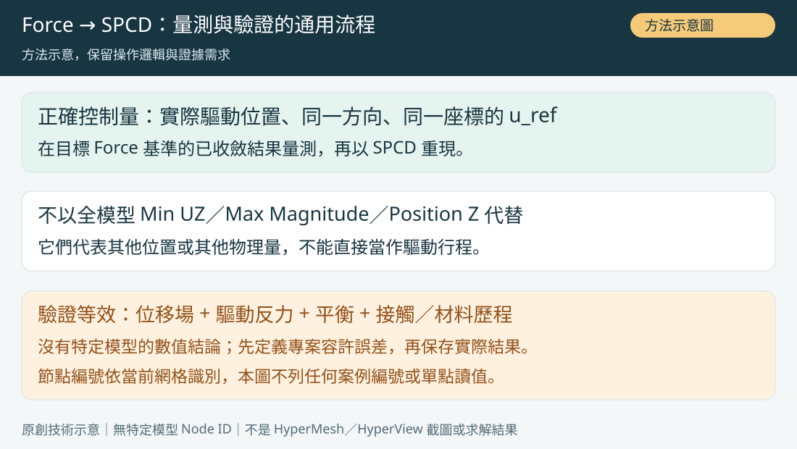

# OCP Rail｜HyperView Stress Legend 60 MPa、平均法與 Reference Node N/A

> 更新：2026-10-29 · 分類：OptiStruct · 類型：技術知識
> 圖片均為重繪示意，非原始軟體截圖；數值屬既有案例紀錄，SPCFORCE 尚待驗證。

[知識庫 local mode 閱讀](../../index.html?source=local#ocp-rail-stress-contour-reading-20261029)

## 知識摘要

圖例固定到 60 MPa，只能說明色階上限，不能證明最大應力等於 60 MPa。比較 Force／SPCD 時要核對原始峰值、平均法與位置；Reference Node 上 Stress N/A 也不等於沒有位移。

## 技術說明

RBE Reference Node 不一定是 Solid 應力的有效評估位置。Stress 可能位於元素／積分點並經外插平均顯示，而 displacement 是 nodal 結果。Nodal Contour 量測跟隨目前套用的 contour；若從 Displacement 切到 Stress，原本量測欄不再是 UZ。既有兩圖 legend 上限均 60 MPa，因此只記錄輪廓外觀接近，未證明真實最大應力相同。

原本 490 N 模型左孔中心 UZ=−1.101 mm；修正後最大位移幅值 2.947 vs 2.948 mm。

## 操作／設定步驟

1. 選相同 subcase 狀態與已收斂 frame，確認 Results type=Stress、component=von Mises、相同 layer／平均與外插設定。

2. 解除固定 60 MPa legend 上限，讀取未截斷峰值及其 element／node 位置；需要看輪廓時再設定共同色階，並另外保存真實 max。

3. 比較元素未平均（unaveraged）與相同平均法結果，關注孔壁與 Insert 周邊；記錄是否存在尖角／點約束奇異性。

4. 若 Reference Node Stress=N/A，改查實際 Solid 應力位置；若要量 UZ，重新 Apply Displacement / Z / Global 再查 Node 26088。

5. 保存相同顯示條件與峰值表；與反力、接觸／塑性狀態一起評估 Force／SPCD 一致性。

## 關鍵參數／判斷規則

- 顏色相近、Legend 相同、最大值接近，是不同證據，不能互相取代。
- 材料 Yield 或 60 MPa 色階上限不是通用破裂判據。
- 比較位移向量長度與比較 UZ 是不同問題。

## 注意事項／限制

尚未取得未截斷 stress 數據，不能補寫真實最大值。延伸：[UZ 與 SPCD 完整教學](ocp-rail-hyperview-node-uz-force-to-spcd.md)、[網格收斂](ocp-rail-tetra4-tetra10-convergence.md)、[失效判定](ocp-rail-test-to-fail-limits.md)

延伸閱讀：[OCP Rail 知識線索引](ocp-rail-force-spcd-test-to-fail.md)

後續專題：[SPCFORCE／NLOUT 與 60 MPa Stress-limit Load](ocp-rail-spcforce-stress-limit.md)（保留上游既有教學，門檻載荷仍待原模型驗證）。

## 參考來源

案例來源：既有 OCP Rail 審核分支保存的 2026-10-28～29 對話／HyperView 2026 截圖轉述。未取得原始 FEM、H3D、OUT 或原始截圖，未執行新一輪 OptiStruct 求解。數值屬既有案例紀錄，不能視為本次獨立驗證。

官方規則核對（2026-10-29；2025／2025.1 文件，介面位置依安裝版本而異）：
- Altair contour: https://2019.help.altair.com/2019/tutorials/hv-3000.pdf
