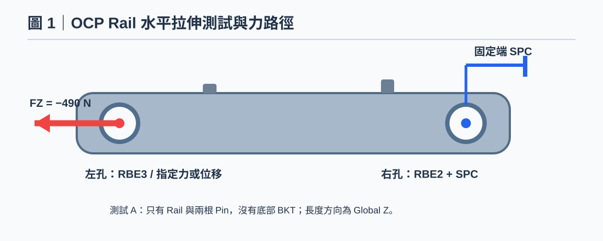

# OCP Rail｜SPCD Test to Fail：F–u 曲線、塑性與破裂判據的界線

> 方法型知識文章；不保留特定模型 Node ID 或單點讀值。所有圖片為示意，非求解結果。

[開啟本機預覽](../../index.html?source=local#ocp-rail-test-to-fail-limits-20261029)

## 知識摘要

完成 Force／SPCD 等效檢查後，可用位移控制逐步建立 Reaction Force–Displacement 曲線。但只有彈塑性材料、超過 Yield 或 Solver 不收斂，都不足以直接宣稱已預測塑膠破裂力。

## 技術說明

位移控制有助於追蹤受載反應；對非線性摩擦／塑性模型，必須保留載入歷程與初始接觸狀態。塑膠裂斷、Insert 拔出、孔壁壓潰與接觸滑移可能是不同模式，需要材料試驗與結構試驗對應。靜力失穩或多重平衡路徑也可能需要更適當的追蹤方法，單一 SPCD 不能保證走完整段失效路徑。

## 操作步驟

1. 先完成[SPCFORCE 等效檢查](#ocp-rail-spcforce-equivalence-20261029)，以 u_ref 作本案例第一個位移基準，反力仍需實際核實。
2. 在相同初始 Press Fit／Contact 狀態下逐步增加負向行程，合理設定非線性增量與輸出，保存已收斂步的 FZ、UZ、塑性應變、接觸滑移／開離。
3. 由驅動端帶符號反力與指定控制點位移建立 F–u 曲線；若與試驗機數據比較，記錄量測位置及治具柔度。
4. 出現 load drop、不收斂或應力超過 Yield 時，分別檢查接觸、失穩、材料參數、網格與數值設定；標記觀察，不直接命名破裂。
5. 若要預測斷裂，取得經校準的損傷／失效模型、適用應變率／溫度與網格客觀性，並以實驗破壞模式、位置與載荷驗證。

## 判讀規則

- 位移、反力與失效模型是不同層次的證據，需分別驗證。
- 不把最後收斂點或 60 MPa 當成破裂載荷。
- 通過單點 Force／SPCD 等效，不代表材料、Contact 與破壞模型已由實測驗證。

## 注意事項

待補：SPCFORCE、Pin + Contact、治具自由度、Press Fit 干涉與摩擦、材料失效資料、Tetra10 收斂序列。延伸：[Press Fit 知識線](#ocp-rail-press-fit-contact-20261029)、[網格收斂](#ocp-rail-tetra4-tetra10-convergence-20261029)

延伸閱讀：[OCP Rail 知識線索引](#ocp-rail-force-spcd-test-to-fail-20261029)

後續專題：[SPCFORCE／NLOUT 與 60 MPa Stress-limit Load](#ocp-rail-spcforce-stress-limit-20261029)（保留上游既有教學，門檻載荷仍待原模型驗證）。

候選方法：[Two-Stage Adaptive Time Increment Control](#optistruct-nlstat-two-stage-adaptive-time-increment-control-20261029)（官方規則已核對，兩階段完整組合待求解驗證）。

## 參考來源

方法型教學；不使用特定模型的節點編號、位移或峰值結果作為操作模板。未執行新的 OptiStruct 求解。官方文件依實際版本核對。

## 圖解

### 測試 A：只有 Rail + 兩根 Pin

水平拉伸力路徑與右端固定，Global Z 為 Rail 長度方向。
