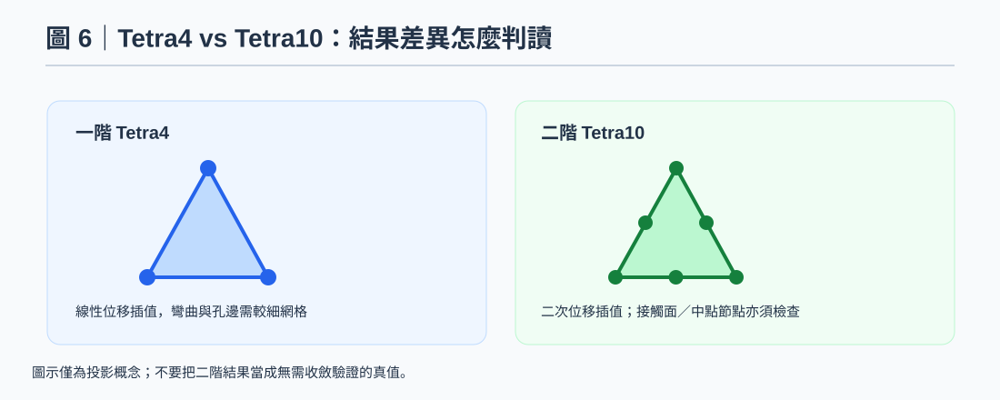

# OCP Rail｜Tetra4／Tetra10：孔邊網格收斂與二階 Contact 檢查

> 更新：2026-10-29 · 分類：OptiStruct · 類型：技術知識
> 圖片均為重繪示意，非原始軟體截圖；數值屬既有案例紀錄，SPCFORCE 尚待驗證。

[知識庫 local mode 閱讀](../../index.html?source=local#ocp-rail-tetra4-tetra10-convergence-20261029)

## 知識摘要

比較一階／二階四面體時，同時核對 RBE 與接觸節點集合、孔壁曲面、中點節點與應力輸出。不能因 Tetra10 的應力較高，就直接判定較接近真實。

Tetra10 可改善部分彎曲及孔邊應力精度，但需核對中點節點、Contact 和網格收斂。

## 技術說明

Tetra4 在彎曲與孔邊梯度明顯處可能偏硬；Tetra10 通常有更佳曲面與位移近似能力。但階次變更會影響接觸面離散、節點集合與非線性收斂路徑。應把整體反力／控制點位移與局部未平均應力分開檢查，不能只比較平均後的一個 Peak。

## 操作／設定步驟

1. 保留相同 Geometry、單位、材料、治具、Contact 與載入歷程；建立各網格版次，記下特徵尺寸與元素階次。

2. 每次重網格後核對 RBE3 REFGRID 與所有孔壁 Gi、Contact 面及 mid-side nodes，避免只沿用舊一階的角點集合。

3. 在孔壁與 Insert 周邊做局部加密序列，檢查元素品質、厚度解析與接觸幾何，勿只全域縮小尺寸。

4. 比較同一實體位置的控制點 UZ、反力、接觸壓力、塑性應變及 unaveraged stress；ID 改變時按實體位置映射，不硬找舊 26088。

5. 保存結果隨尺寸／階次的變化；若峰值持續發散，檢查點約束、尖角或接觸奇異性，以工程評估區域或實驗量測位置對照。

## 關鍵參數／判斷規則

- 相同節點 ID 不保證相同實體位置；不同網格要重新識別控制點。
- 接觸設定與初始狀態若改變，結果差異不能全歸因於階次。
- 沒有通用的幾個元素就足夠或峰值收斂門檻；依目標量與精度需求判定。

## 注意事項／限制

原紀錄尚未提供收斂序列表，本次不新增虛構結果。相關：[RBE 孔壁節點](ocp-rail-rbe-hole-nodes-autospc.md)、[應力平均與 Legend 判讀](ocp-rail-stress-contour-reading.md)

延伸閱讀：[OCP Rail 知識線索引](ocp-rail-force-spcd-test-to-fail.md)

## 參考來源

案例來源：既有 OCP Rail 審核分支保存的 2026-10-28～29 對話／HyperView 2026 截圖轉述。未取得原始 FEM、H3D、OUT 或原始截圖，未執行新一輪 OptiStruct 求解。數值屬既有案例紀錄，不能視為本次獨立驗證。

官方規則核對（2026-10-29；2025／2025.1 文件，介面位置依安裝版本而異）：
