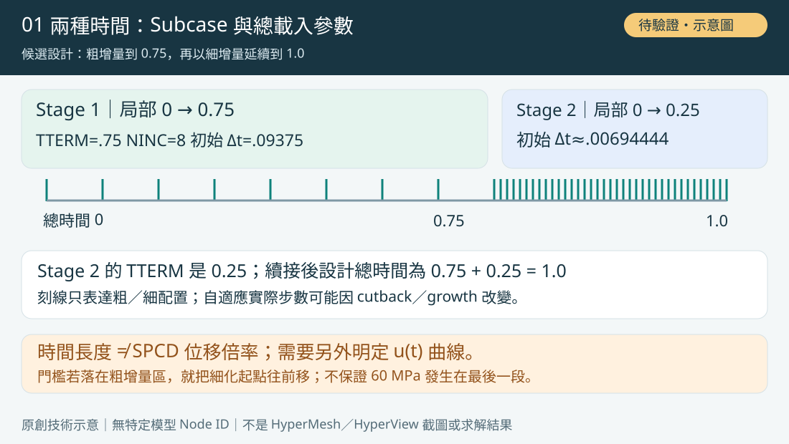
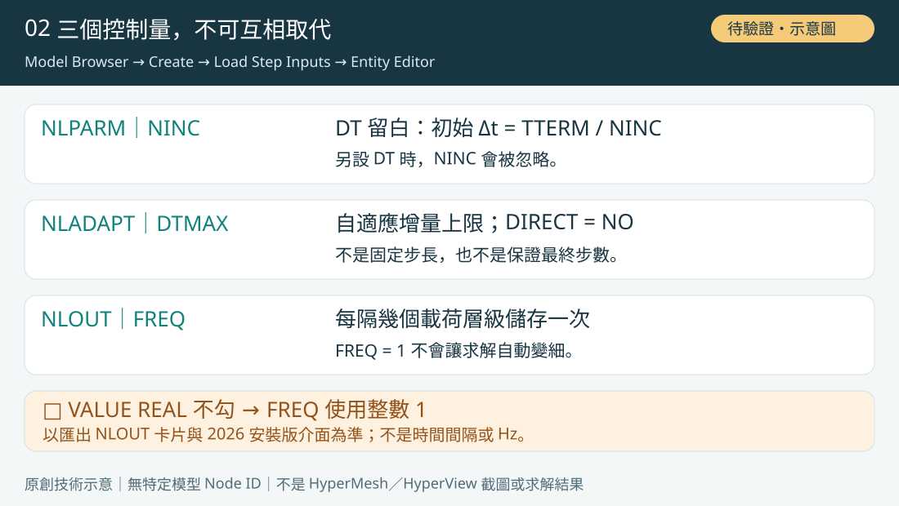
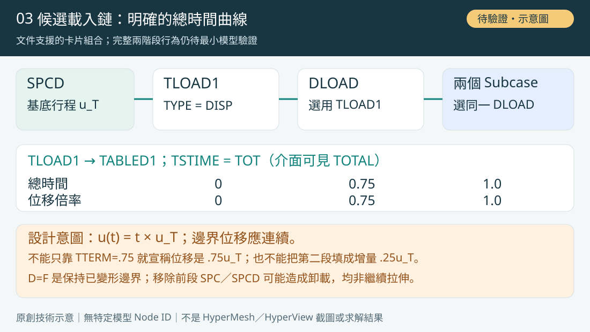
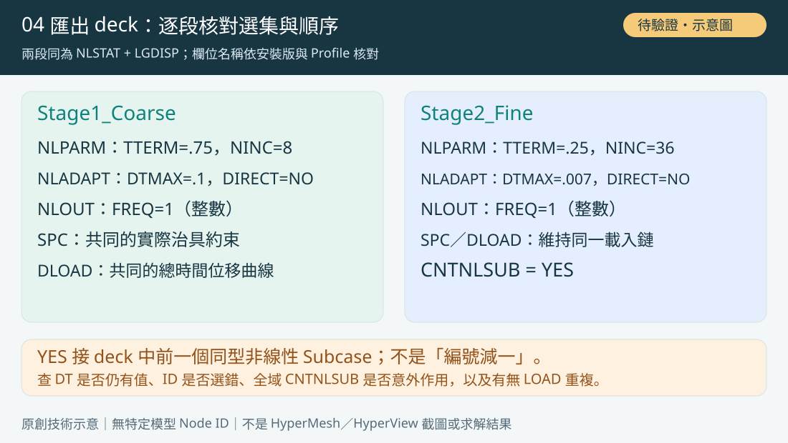
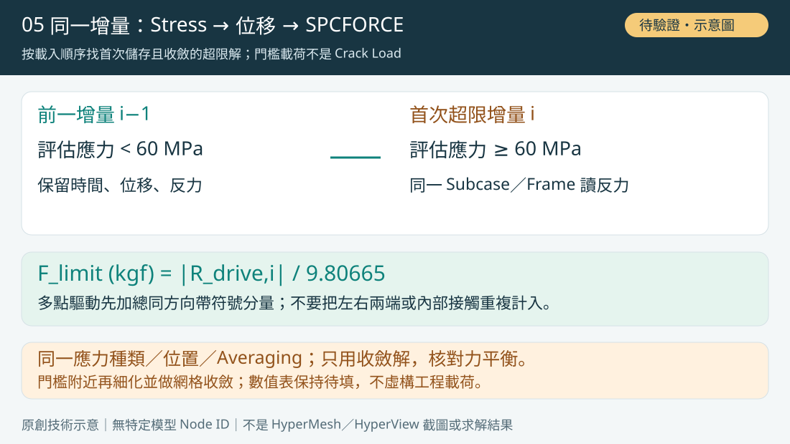

# OptiStruct NLSTAT – Two-Stage Adaptive Time Increment Control

> 方法型知識文章；特定模型 Node ID 與案例讀值已移除。圖為原創／重繪示意，非求解證據。

[開啟本機預覽](../../index.html?source=local#optistruct-nlstat-two-stage-adaptive-time-increment-control-20261029)

## 知識摘要

【審核草案／尚未完成求解驗證】分類：OptiStruct / Nonlinear Analysis（軟體分類／主題標籤）。目標是在總載入參數 Time 0–0.75 使用粗增量，0.75–1.0 使用細增量，按載入順序找材料首次達到專案 60 MPa 門檻時同增量的 SPCFORCE。
2026 官方文件已核對卡片語意；候選數值、完整兩階段載入組合與 HyperMesh 操作仍須以實際 2026 安裝版與小模型試跑確認。本文不含特定 Node ID、案例位移或虛構反力。

## 官方規則、候選設定與載入設計

【文件已確認：時間與步長】NLPARM 的 TTERM 使用各 Subcase 的局部持續時間。未另設 DT 時，初始步長為 TTERM/NINC；一旦指定 DT，NINC 會被忽略。NLADAPT 的 DIRECT=NO 採自適應增量，DTMAX 限制增量上限；NLOUT 的 FREQ 僅控制儲存頻率，不會加密求解。

【候選數值／非驗證成果】Stage 1：TTERM=0.75、NINC=8、DT 留白；DTMAX=0.1、DIRECT=NO；NLOUT FREQ=1。Stage 2：TTERM=0.25、NINC=36、DT 留白；DTMAX=0.007、DIRECT=NO；NLOUT FREQ=1，CNTNLSUB=YES。依公式計算初始步長分別 0.09375 與約 0.00694444；這是設定算術，不是觀察到的步長。自適應 cutback／growth 會改變實際增量數，不保證剛好 8 與 36 步，也不保證更快。

【文件已確認：續接】CNTNLSUB=YES 接續 deck 順序中前一個同型非線性 Subcase；SID 可明確指定前一 Subcase。它續接已求解狀態，不會自動替你建立想要的 SPCD 曲線。移除上一階段的 SPC／SPCD／外力會引發等效內力逐步卸載；D=F 用於保持前段變形邊界，不能當作繼續增加行程。

【候選載入設計：明定總時間曲線】先定義終點帶符號位移 u_T。設計意圖為 u(t)=t×u_T：總時間 0、0.75、1.0 分別為 0、0.75u_T、u_T。可用同一 SPCD 作基底，透過 TLOAD1 的 TYPE=DISP、TID 曲線及 TSTIME=TOT，再由兩個 NLSTAT Subcase 的 DLOAD 選用；官方文件支援 NLSTAT 的這類曲線與總時間切換。本文將此完整組合作為待測方案，尚未執行邊界連續性驗證。

【不要混淆兩種控制】只填 TTERM=0.75 並沿用直接 LOAD 的完整 SPCD 目標，不足以證明 Stage 1 停在 75% 行程。若改採兩個直接 LOAD／SPCD 端點，必須另外確認該版 Solver 的端點解讀與續接 ramp，不能把第二段直接填成 0.25u_T 當作增量。主教學採明定總時間曲線的候選方式，避免把時間長度誤當位移倍率。

## HyperMesh 2026 操作步驟

1. 確認工作副本與適用範圍：HyperMesh 2026 New Session 選 OptiStruct Profile，匯入配對 Solver Deck。保持原材料、接觸、治具及 LGDISP 條件；本教學是 NLSTAT 載入參數控制，不是實際試驗速度控制。先另存工作版本。
2. 先定義物理載入：在模型上識別驅動控制點與對應方向，使用符號 u_T 表示終點行程。列出預期三點曲線 (總時間, 位移倍率)=(0,0)、(0.75,0.75)、(1,1)。對不同載入歷程另建曲線，不從 60 MPa 推定位移，也不預設門檻一定發生在最後四分之一。
3. 建立兩張 NLPARM：Model Browser 空白處右鍵 Create → Load Step Inputs，在 Entity Editor 選 Config type=Nonlinear Parameters、Type=NLPARM，命名 NLPARM_STAGE1／NLPARM_STAGE2。輸入 Stage 1 的 NINC=8、TTERM=0.75，Stage 2 的 NINC=36、TTERM=0.25；DT 保持未指定。保留經批准的收斂準則，不能為了加速任意放寬。
4. 建立兩張 NLADAPT：同一 Create → Load Step Inputs，Config type=Time step Parameters、Type=NLADAPT，命名 NLADAPT_STAGE1／NLADAPT_STAGE2。分別啟用 DTMAX=0.1／0.007，DIRECT 都選 NO。檢查 DTMIN、NCUTS 與其他既有控制，不混用另一套 NLCTRL 控制；它們不在這份候選數值的已驗證範圍。
5. 建立 NLOUT：Create → Load Step Inputs，Config type=Output Parameters、Type=NLOUT。選輸出選項 FREQ，整數 Value 填 1，VALUE REAL 不勾；讓匯出卡片為 NLOUT,<輸出ID>,FREQ,1。NLOUT 頁面可有整數與實數欄位切換，但 FREQ 的 Solver 定義是正整數；不是填 1.0 秒或 0.007。兩段可共用同一 NLOUT。
6. 只將收斂解用於判定：可在 NLOUT 設 SVNONCNV=NO，或保留非收斂診斷結果但在後處理明確排除。不要以 FREQ=1 宣稱每次 Newton iteration 都是有效結果；若同時殘留 TIME／NINT，先移除衝突，核對 TIME 優先於 FREQ、FREQ 優先於 NINT。
7. 建立 SPC 與 SPCD：在 Model Browser 建立相應 Load Collectors，再由 Analyze → BCs／Constraints 的約束建立功能，選實際控制點與 Component。兩階段的有效 SPC 都要包含 SPCD 的同一自由度；其他治具自由度按實際條件維持。SPCD 的 D 使用基底幅值 u_T，符號、單位與有效座標必須一致。不要填入舊案例 Node ID，也不要另疊加已替代的驅動 FORCE。
8. 建立候選 TLOAD1 曲線載入：建立 TABLED1 曲線，使用總時間與倍率三點 (0,0)、(0.75,0.75)、(1,1)；建立 TLOAD1，EXCITEID 選 SPCD、TYPE=DISP、TID 選此曲線，DELAY 留白／零，EXTN 的 TSTIME 選 TOT（介面可能標 TOTAL）。再用 DLOAD 組合選取 TLOAD1，倍率為 1。這是待試跑的載入鏈，不把 SPCD 包進 Bulk Data LOAD combination。此路徑以 DLOAD 選用，不再同時以 LOAD 引用同一 SPCD。
9. 建立 Stage 1：Model Browser → Create → Load Step，命名 Stage1_Coarse，Analysis type=Non-linear static（NLSTAT）。SPC 選作用約束集合、DLOAD 選上一步載入、NLPARM(LGDISP) 選 NLPARM_STAGE1、NLADAPT 選 NLADAPT_STAGE1、NLOUT 選輸出控制。若專案以全域 PARAM,LGDISP,1 啟用 LGDISP，保留一致的既有方式。第一段不續接其他歷程，確認沒有全域 CNTNLSUB 意外套用。
10. 複製並建立 Stage 2：命名 Stage2_Fine，放在 Stage 1 後面，保持相同 NLSTAT／LGDISP、SPC 與同一總時間 DLOAD 曲線。切換 NLPARM_STAGE2 與 NLADAPT_STAGE2，保留 NLOUT；在該 Load Step 的 Subcase Definition／選用欄位啟用 CNTNLSUB=YES。檢查 deck 順序真的是前一段；若中間會插入其他 Subcase，改用明確的前段 SID 並重新驗證。
11. 核對兩種時間：Stage 1 的局部時間 0–0.75，Stage 2 的局部時間 0–0.25，設計總時間分別 0–0.75 與 0.75–1.0。TLOAD1 使用 TOT 才沿同一總時間曲線查值；若改 SUB，第二段會從自己的局部零開始查表，必須另設表格與起點，不能照抄本候選。
12. 建立結果輸出：Analyze ribbon 的 Run 工具組選 Control Cards → GLOBAL_OUTPUT_REQUEST，請求 SPCFORCE(H3D)=ALL、DISPLACEMENT(H3D)=ALL、STRESS(H3D)=ALL；確認兩段都有效。需要時補接觸與材料歷程輸出。此處 ALL 是結果範圍，NLOUT 才控制中間增量儲存。
13. 匯出 .fem／Solver Deck 逐項核對：兩個 SUBCASE、ANALYSIS NLSTAT、SPC、DLOAD、NLPARM／LGDISP、NLADAPT、NLOUT 與第二段 CNTNLSUB。再查 Bulk 的 TTERM、NINC、空白 DT、DTMAX、DIRECT、整數 FREQ=1、TLOAD1 TYPE=DISP／TSTIME=TOT、TABLED1 與各 ID 對應。不要只看實體名稱；本文示意片段不包含可直接求解的幾何與邊界模型。
14. 先做最小驗證：使用可確認反應的簡單彈性模型，保留一致單位。檢查第一段終點 u/u_T≈0.75、第二段起點連續、總終點 u/u_T≈1，沒有意外卸載／跳位移；並對照單段全細步解的力–位移曲線。這是待執行驗證，不是本篇已有結果。
15. 再跑工程模型並讀 .out／_nl.out：核對實際起訖總時間、局部 TTERM、實際步長與 cutback、收斂、接觸及材料歷程。確認第二段沒有回到初始應力自由狀態。若不收斂，記錄中止與原因，不將最後收斂點命名為材料失效。
16. HyperView 載入同次求解模型與 H3D，依 Stage 1→Stage 2 的載入順序檢查已收斂結果，保持相同材料區域、應力種類、Centroid／Corner 與 Averaging。保存 Subcase、Frame、顯示 Time 及其局部／總時間對應；在這些位置讀真實應力數值，不用 60 MPa Legend 截斷色階代替門檻。
17. 找第一個評估應力 ≥60 MPa 的已儲存已收斂增量 i，並保留前一低於門檻的 i−1。保持同一 Subcase／Frame，切 SPC Forces → 載入方向分量，Resolved in 共同座標，透過 Node Query／Nodal Contour 讀實際驅動位置的帶符號反力；多點治具先做分量加總或投影，再取絕對值換算 kgf。F_limit=|R_drive|/9.80665，並以全部外部作用查平衡，不重複計左右端。
18. 完成可審查的門檻報告：保存 i−1／i 的時間、實際位移、應力、反力、kgf、收斂與顯示設定；在門檻附近進一步縮小 DTMAX／初始步長做時間增量敏感度，再做網格收斂。若首次超限落在 Stage 1，就把細化區間往前移；沒有達門檻則記為所求行程內未達。結論稱 Predicted Load at 60 MPa Stress Limit，不稱真正 Crack Load。

## 參數差異與判讀規則

- NINC：分段初始離散，DT 留白時 Δt_initial=TTERM/NINC；不是自適應模式最終步數。
- DTMAX：自適應步長上限，不是輸出頻率，也不是保證每步固定大小。Stage 2 初始約 0.00694444 小於候選上限 0.007。
- FREQ=1：每個指定載荷層級儲存增量結果，不會改變求解步長、不會儲存每次 Newton 迭代為有效解。VALUE REAL 不勾，匯出核對整數 1。
- TTERM=0.25 是第二段的持續時間；不是總時間終點 0.25，也不等於 25% 位移。總時間與 Subcase time 必須分開記錄。
- TSTIME=TOT 與 TTERM 的時間定義不同：前者決定曲線查值用總時間，後者定義本段長度。
- CNTNLSUB=YES 依 deck 順序續接同型前段，非依編號大小。省略續接、移除邊界、D=F 凍結，都不能當作同一個持續增加 SPCD 的操作。
- 60 MPa 是專案指定判據，需核准應力種類與材料適用性；Time 不是反力倍率，首次儲存超限幀也不是精確的連續門檻。

## 限制與常見錯誤

【常見錯誤→驗證】第二段 TTERM 寫成 1.0：查局部／總時間，避免總長變成 1.75。NINC 改了卻沒效果：查是否仍指定 DT。步長仍太粗：查該 Subcase 的 NLADAPT 選集、DTMAX 與增量紀錄。只改 FREQ：這只能增加存檔，不能細化解。

【續接錯誤→驗證】Stage 1 已拉到完整行程：TTERM 不自動縮放直接 LOAD 的 SPCD；檢查實際 u/u_T。Stage 2 卸載／跳變：查 SPC／SPCD 是否移除、LOAD／DLOAD 是否重複、TSTIME 是否誤用 SUB、曲線起點及 CNTNLSUB 的前段目標。將 D=F 用於驅動點會保持前段邊界，不是拉到更大行程。

【結果錯誤→驗證】非收斂 Frame、跨步 Envelope、不同平均法、錯材料範圍或把 SPC Force Magnitude 當軸向反力，都可能造成門檻誤判。局部尖峰需查理想化與網格收斂；未平均應力也不自動等於真實材料應力。

【審核狀態】官方 2026 線上說明於 2026-10-29 查核；本文操作位置依官方 HyperMesh 教學整理，未在本機 HyperMesh 2026 逐項實機點選。VALUE REAL 的實際欄位呈現須核對安裝版；Solver 正整數 FREQ 規則已確認。候選參數組合、SPCD 續接連續性、效能與 60 MPa 對應反力均未經 Solver 試跑。所有圖均為原創示意，不是 UI 截圖或求解結果。

延伸閱讀：[OCP Rail 知識線索引](#ocp-rail-force-spcd-test-to-fail-20261029)、[HyperView UZ→SPCD](#ocp-rail-hyperview-node-uz-force-to-spcd-20261029)、[SPCFORCE 與應力門檻](#ocp-rail-spcforce-stress-limit-20261029)。

## 官方來源

2026 官方文件查核日期：2026-10-29。下列 root 線上說明的版本導覽顯示 2026；未以舊版規則冒稱 2026 已測通。
NLPARM（TTERM 為 Subcase time；DT／NINC 優先序）：https://help.altair.com/hwsolvers/os/topics/solvers/os/nlparm_bulk_r.htm
NLADAPT（DTMAX、DIRECT）：https://help.altair.com/hwsolvers/os/topics/solvers/os/nladapt_bulk_r.htm
NLOUT（FREQ、NINT、TIME 及中間結果）：https://help.altair.com/hwsolvers/os/topics/solvers/os/nlout_bulk_r.htm
CNTNLSUB（狀態續接、移除邊界時卸載、D=F）：https://help.altair.com/hwsolvers/os/topics/solvers/os/cntnlsub_sub_r.htm
SPCD（指定運動及作用 SPC 自由度）：https://help.altair.com/hwsolvers/os/topics/solvers/os/spcd_bulk_r.htm
TLOAD1（NLSTAT 的 DLOAD 曲線、DISP、TSTIME）：https://help.altair.com/hwsolvers/os/topics/solvers/os/tload1_bulk_r.htm
SPCFORCE（H3D 反力輸出）：https://help.altair.com/hwsolvers/os/topics/solvers/os/spcforce_io_r.htm
HyperMesh analysisparameters（VALUE REAL 與整數 FREQ）：https://help.altair.com/hwdesktop/hwd/topics/reference/hm/data_names-analysisparameters_r.htm
HyperMesh 2026 官方操作參照 OS-HM-T 3000：https://help.altair.com/hwsolvers/os/topics/solvers/os/rubber_ring_hwx_tutorial_r.htm
NLSTAT 續接官方教學 OS-HM-T 3020：https://help.altair.com/hwsolvers/os/topics/solvers/os/nlstat_analysis_solid_blocks_in_contact_intro_r-1.htm

## 候選設定對照（未求解驗證）

| 項目 | Stage 1 | Stage 2 |
| --- | --- | --- |
| 設計總時間範圍 | 0–0.75 | 0.75–1.0 |
| NLPARM TTERM（局部持續時間） | 0.75 | 0.25 |
| NLPARM NINC；DT 留白 | 8 | 36 |
| 初始 Δt（算術） | 0.09375 | 0.00694444… |
| NLADAPT DTMAX | 0.1 | 0.007 |
| DIRECT | NO | NO |
| NLOUT FREQ；VALUE REAL 不勾 | 整數 1 | 整數 1 |
| CNTNLSUB | 不續接其他歷程 | YES，明確接前段 |

## 設定核對骨架（不可直接求解）

以下為閱讀匯出 deck 的檢查表，角括號是必須由實際模型替換的參照；沒有模型、材料、SPC 或 NLPARM 完整 Bulk 配置，不能當作已驗證 FEM。主方案使用 DLOAD 時不要又用 LOAD 疊加 SPCD。

```text
SPCFORCE(H3D) = ALL
DISPLACEMENT(H3D) = ALL
STRESS(H3D) = ALL
SUBCASE <stage1>
  ANALYSIS = NLSTAT
  SPC = <same constraints>
  DLOAD = <global-time displacement history>
  NLPARM(LGDISP) = <TTERM .75 / NINC 8 / DT blank>
  NLADAPT = <DTMAX .1 / DIRECT NO>
  NLOUT = <FREQ integer 1>
SUBCASE <stage2>
  ANALYSIS = NLSTAT
  CNTNLSUB = YES
  SPC = <same constraints>
  DLOAD = <same global-time displacement history>
  NLPARM(LGDISP) = <TTERM .25 / NINC 36 / DT blank>
  NLADAPT = <DTMAX .007 / DIRECT NO>
  NLOUT = <FREQ integer 1>
```

## 正式發布前的驗證記錄（待填）

| 驗證 | 應保存證據 | 狀態 |
| --- | --- | --- |
| 安裝版介面／匯出 | 2026 build、卡片、VALUE REAL 對應 | 待實機確認 |
| 最小彈性模型續接 | u/u_T 在邊界為 .75，終點為 1；無跳變／卸載 | 待 Solver 試跑 |
| 步長控制 | .out／_nl.out 實際 Δt、cutback、總／局部時間 | 待 Solver 試跑 |
| 門檻與反力 | i−1／i 的同幀 stress、u、SPCFORCE、kgf | 待工程模型 |
| 精度與效能 | 全細步參考、增量敏感度、網格收斂、耗時 | 待比較 |

## 官方文件定位

- [NLPARM（TTERM 為 Subcase time；DT／NINC 優先序）](https://help.altair.com/hwsolvers/os/topics/solvers/os/nlparm_bulk_r.htm)
- [NLADAPT（DTMAX、DIRECT）](https://help.altair.com/hwsolvers/os/topics/solvers/os/nladapt_bulk_r.htm)
- [NLOUT（FREQ、NINT、TIME 及中間結果）](https://help.altair.com/hwsolvers/os/topics/solvers/os/nlout_bulk_r.htm)
- [CNTNLSUB（狀態續接、移除邊界時卸載、D=F）](https://help.altair.com/hwsolvers/os/topics/solvers/os/cntnlsub_sub_r.htm)
- [SPCD（指定運動及作用 SPC 自由度）](https://help.altair.com/hwsolvers/os/topics/solvers/os/spcd_bulk_r.htm)
- [TLOAD1（NLSTAT 的 DLOAD 曲線、DISP、TSTIME）](https://help.altair.com/hwsolvers/os/topics/solvers/os/tload1_bulk_r.htm)
- [SPCFORCE（H3D 反力輸出）](https://help.altair.com/hwsolvers/os/topics/solvers/os/spcforce_io_r.htm)
- [HyperMesh analysisparameters（VALUE REAL 與整數 FREQ）](https://help.altair.com/hwdesktop/hwd/topics/reference/hm/data_names-analysisparameters_r.htm)
- [HyperMesh 2026 官方操作參照 OS-HM-T 3000](https://help.altair.com/hwsolvers/os/topics/solvers/os/rubber_ring_hwx_tutorial_r.htm)
- [NLSTAT 續接官方教學 OS-HM-T 3020](https://help.altair.com/hwsolvers/os/topics/solvers/os/nlstat_analysis_solid_blocks_in_contact_intro_r-1.htm)

## 步驟圖解

### Step 11｜局部時間、總時間與候選步長



原創技術示意圖；候選設計尚未完成求解驗證，非 HyperMesh 截圖或工程結果。

### Step 5｜NINC、DTMAX 與 FREQ 各管什麼



原創技術示意圖；候選設計尚未完成求解驗證，非 HyperMesh 截圖或工程結果。

### Step 8｜SPCD 總時間曲線與續接載入鏈



原創技術示意圖；候選設計尚未完成求解驗證，非 HyperMesh 截圖或工程結果。

### Step 10｜兩階段 Subcase 欄位核對



原創技術示意圖；候選設計尚未完成求解驗證，非 HyperMesh 截圖或工程結果。

### Step 17｜同增量應力門檻與反力讀取



原創技術示意圖；候選設計尚未完成求解驗證，非 HyperMesh 截圖或工程結果。
